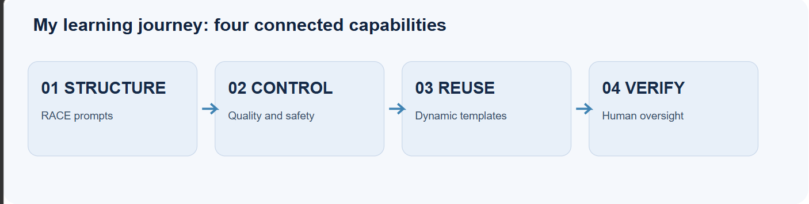
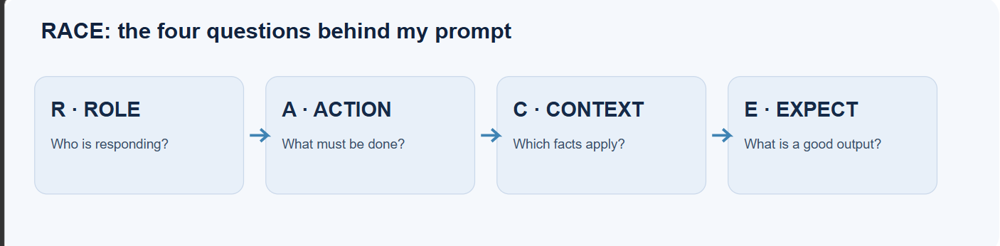
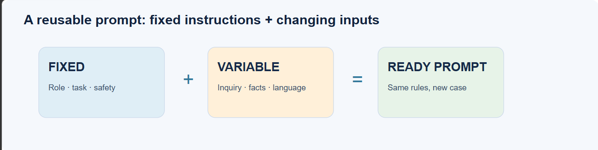
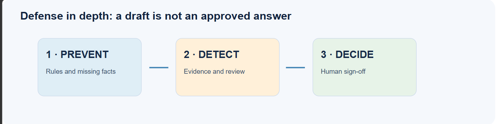
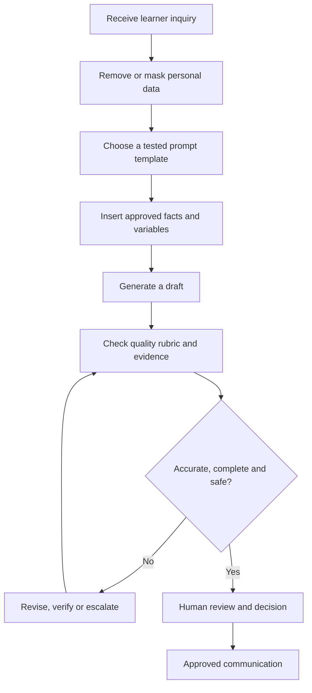

# Prompt Engineering & Responsible AI Use
### My Training Reflection and Learning Report

| | |
|---|---|
| **Program** | Prompt Engineering & Responsible AI Use — SDAIA Academy |
| **Location & dates** | Riyadh, Saudi Arabia · 11–15 October 2026 |
| **Instructor** | [Abdullah Khalid Alshahrani](https://www.linkedin.com/in/abdullah-alshahrani-9125bb2a0/) |
| **Author** | Alhanouf Aldossary |
| **Final project** | [TC Prompt Library — Learner Support Desk](README.md) |

> [!IMPORTANT]
> **My biggest lesson:** Prompt engineering is not about finding a magic sentence that makes AI smart. It is about designing clear instructions, controlling quality, reusing what works, and taking responsibility for the result.



---

## Contents

1. [Executive summary](#executive-summary)
2. [Day 1 — Prompting Foundations and the RACE Method](#day-1--prompting-foundations-and-the-race-method-)
3. [Day 2 — Consistent Quality and Output Control](#day-2--consistent-quality-and-output-control-%EF%B8%8F)
4. [Day 3 — Reusable Dynamic Templates](#day-3--reusable-dynamic-templates-%EF%B8%8F)
5. [Day 4 — Verification and Responsible AI Use](#day-4--verification-and-responsible-ai-use-%EF%B8%8F)
6. [Day 5 — Final Project: My Prompt Library](#day-5--final-project-my-prompt-library-)
7. [Putting it together: my workflow](#putting-it-together-my-workflow-)
8. [Skills I developed](#skills-i-developed)
9. [Final reflection](#final-reflection)
10. [Sources and attribution](#sources-and-attribution)

---

## Executive summary

I joined the *Prompt Engineering & Responsible AI Use* program to learn how AI assistants can be used effectively — and safely — in practical work. Each day built on the one before:

| Day | Capability | In one line |
|:---:|---|---|
| 1 | **Structure** | Write clear prompts with RACE. |
| 2 | **Control** | Get consistent, high-quality, private output. |
| 3 | **Reuse** | Turn good prompts into dynamic templates. |
| 4 | **Verify** | Check evidence and keep a human responsible. |
| 5 | **Apply** | Build, test and approve a real prompt library. |

The program used a *Beneficiary Service Desk* scenario, in which a team answers questions, summarizes requests and drafts messages. Working through one consistent example taught me to stop treating each AI response as a standalone answer and to think about the whole process instead: what information the assistant receives, what it is allowed to do, what format it must follow, what could go wrong, and who reviews the output.

---

## Day 1 — Prompting Foundations and the RACE Method 🧩

### How I now understand prompting

A prompt is more than a question. It includes the instructions and information that guide an AI assistant's response. A request can be grammatically correct and still produce an unusable answer if it fails to explain the purpose, audience, constraints or expected form.

Asking an assistant to "write a reply," for example, leaves many questions open. Who am I replying as? Which facts can be used? Arabic or English? How long? Does it need a next step? The training named the common causes of weak prompts: **unclear goals, missing context, too many tasks, no defined format, and no review**.

### RACE gave me a structure

The core technique was **RACE — Role, Action, Context, Expectation**.



| Component | What I learned | How I use it |
|---|---|---|
| **Role** | Give the assistant a clear professional perspective. | "Act as a training-center service desk agent." |
| **Action** | State the task and the order of steps. | "Identify the learner's questions, then draft a reply." |
| **Context** | Supply the facts, audience and rules for the task. | Include the approved policy facts and the masked inquiry. |
| **Expectation** | Define what a good result looks like. | Specify language, tone, length and output sections. |

The key insight for me: **context is not optional**. If a rule is specific to an organization, the assistant cannot know it unless I provide it. I also learned to treat every AI output as a draft — especially when it mentions names, figures, dates or policies.

### Improving prompts is a deliberate process

The course introduced a refinement loop — **Write → Run → Review → Adjust** — and a useful way to give feedback: **evidence + effect + edit**. Instead of saying "this reply is bad," I point to the unsupported promise, explain why it is risky, and tell the assistant to remove it.

> [!TIP]
> **My takeaway:** The first output is a starting point. I get better results by improving the instruction, not by endlessly fixing individual replies.

---

## Day 2 — Consistent Quality and Output Control 🎛️

### A good answer once is not enough

A prompt that produces one convincing reply might fail on the next request. What matters is whether responses stay **accurate, complete, polite, correctly formatted and actionable** across different inputs.

The course used a five-point quality rubric, which I apply like this:

| Check | Question I ask | Pass condition |
|---|---|---|
| **Accuracy** | Does every factual statement come from the supplied facts? | No invented rules or details. |
| **Completeness** | Did the reply cover every question? | No question skipped. |
| **Next step** | Does the learner know what to do next? | One clear, supported action. |
| **Tone** | Is the wording calm and professional? | No blame or unsupported promises. |
| **Format & language** | Does the answer follow the agreed template? | Correct structure, length and language. |

Each check scores **0 or 1**. A score of **5/5 means ready for human review** — not ready to send. A checklist helps, but it does not replace judgment.

### What output control looks like

I learned to reduce variation by keeping a fixed prompt structure, separating facts from the incoming request, adding explicit rules, giving a sample output when useful, splitting complex tasks into steps, and telling the assistant what to do when information is missing. Arabic and English output both need explicit language instructions.

A rule like **"Use only the supplied facts. If an answer is missing, say it is unavailable and refer the learner to the official channel"** is far more useful than "be accurate," because it tells the assistant exactly how to handle uncertainty.

### Privacy starts before prompting

Names, phone numbers, emails, ID numbers, addresses, bank details and passwords should never be casually pasted into an AI tool. We learned to **mask** personal data with consistent labels such as `User-1`, `Phone-1` and `Email-1`, or to remove it entirely:

```text
Original (training-style example):
A learner named [PERSON] asked about a certificate and provided a phone number.

Masked working input:
User-1 asked about a certificate. Contact: Phone-1.
```

The masked version still lets the assistant do the communication task while exposing far less personal information. Any mapping back to the real details stays outside the prompt.

> [!TIP]
> **My takeaway:** Reliable AI use needs a repeatable standard, not one impressive example. Privacy and quality are part of prompt design, not last-minute additions.

---

## Day 3 — Reusable Dynamic Templates ♻️

### From writing again to designing once

Day 3 tackled an everyday problem: copying an old prompt, editing several lines, and hoping nothing from the previous case is left behind. The solution is a **dynamic template** — fixed instructions plus clearly named slots for the parts that change.



Variables are written in square brackets, such as `[INQUIRY]`, `[LANGUAGE]`, `[TONE]`, `[MAX_WORDS]` and `[DESK_FACTS]`. Clear names make the slots easy for anyone to fill correctly, while the critical rules stay locked in place.

### My example of a reusable prompt

An original template I wrote based on the concepts from the program:

```text
ROLE:
You are a learner support agent at a training center.

ACTION:
1. Read the inquiry and identify every question.
2. Answer each question using only [APPROVED_FACTS].
3. If a fact is missing, do not guess; say it needs checking.
4. End with one clear next step.

CONTEXT:
[APPROVED_FACTS]

LEARNER MESSAGE:
---
[MASKED_INQUIRY]
---

SAFETY RULES:
- Do not invent dates, amounts, status updates, or policies.
- Do not request passwords, ID numbers, or banking details.
- A staff member must review the draft before sending.

EXPECTATION:
Language: [LANGUAGE]
Tone: [TONE]
Maximum length: [MAX_WORDS] words
Format: Greeting / Answer / Next step / Closing
```

The same template works for a certificate question, a registration inquiry or a schedule request — as long as I supply the right approved facts and masked input. If the *task itself* changes (for example, from replying to **classifying** requests), I create a separate template instead of forcing one prompt to do everything.

### Why a prompt library matters

A prompt library is a collection of **named, tested and reusable instructions**. Each entry states its purpose, variables, limits and test status. A shared library stops a team from drifting into slightly different versions of the same rule and makes updates easy to manage.

> [!TIP]
> **My takeaway:** A prompt becomes truly valuable when someone other than its author can understand, test and reuse it.

---

## Day 4 — Verification and Responsible AI Use 🛡️

### Sounding correct is not the same as being correct

Day 4 focused on **hallucinations** — outputs that sound plausible but contain false or unsupported information. At a service desk, that could mean inventing a refund date, claiming a request was approved, quoting a policy that was never supplied, or implying an action was already taken.

A professional tone is not evidence. An answer can also follow the prompt perfectly and still be wrong if the facts it relies on are out of date — so verification has to look beyond whether the AI obeyed the prompt.

### Three layers of protection



| Layer | What happens |
|---|---|
| **1 · Prevent** | Explicit rules and missing-information instructions are built into the template. |
| **2 · Detect** | The response is checked against the inquiry, the approved facts and any current notice. |
| **3 · Decide** | A person corrects, escalates, approves or rejects the draft. |

A good review asks: *What does the output claim? Where did that claim come from? Does the evidence support it? Was any question skipped? Does the answer imply a promise no one authorized?*

### Responsible use is a working practice

Verification connects to **privacy, fairness, organizational policy and human accountability**. A responsible workflow minimizes sensitive input, checks for unsupported assumptions or unfair treatment, communicates uncertainty instead of hiding it, and leaves the final decision with staff. Keeping source facts current is part of the job too — a well-written prompt cannot fix an outdated policy.

> [!TIP]
> **My takeaway:** Responsible AI is not achieved by adding "be ethical" at the end of a prompt. It needs safeguards before, during and after generation.

---

## Day 5 — Final Project: My Prompt Library 🏁

On the final day, I applied everything from Days 1–4 to build a complete prompt library for a **Learner Support Desk at a Training Center** (prefix `TC`).

| | |
|---|---|
| **Templates built** | 5 — reply to inquiries, summarize complaints, classify requests, soften staff drafts, mask learner details |
| **Testing** | Each template tested in ChatGPT with two different fills and one edge case, in fresh chats |
| **Result** | All 5 templates scored full marks and were **approved** |
| **Iteration** | Two templates needed one fix and a retest; their first versions are archived |
| **Shared blocks** | One approved Facts block and one Rules file used by every template |

How each day shows up in the project:

- **Day 1 → RACE:** every template follows Role, Action, Context, Expectation.
- **Day 2 → Control:** fixed output formats, the Facts block as the only source of policy, and a masking template.
- **Day 3 → Reuse:** variables, versioned file names and a library index.
- **Day 4 → Verify:** a CHECK section in every template and human approval before anything is sent.

📂 Full project, templates and test report: **[TC Prompt Library](README.md)**

---

## Putting it together: my workflow 🔧

This is my own synthesis of the program — how I would apply these lessons at a training-center service desk:



### How I would measure success

I would build a small test set with different inquiry types, Arabic and English cases, multi-question messages, and cases where a fact is deliberately missing. I would score outputs against the five quality checks, track recurring errors, and update the prompt or the fact source. I would also record how often a reviewer had to correct unsupported claims.

Speed alone is not success. A fast reply that invents a policy or leaks personal data is not an improvement. The real goal is to reduce avoidable rework **while keeping quality and accountability**.

---

## Skills I developed

| Skill | What it means for my work |
|---|---|
| 🧠 **Structured thinking** | I can break an unclear request into role, task, evidence and expected output. |
| ✅ **Quality assurance** | I evaluate answers against defined criteria, not on whether they "sound good." |
| ♻️ **Template design** | I can create reusable instructions for recurring work. |
| 🔒 **Information handling** | I recognize when information should be masked, withheld or verified. |
| 🔍 **Critical review** | I can spot hallucinations, missing answers and unsupported promises. |
| ⚙️ **Process improvement** | I can connect AI assistance to a human-controlled workflow. |

These skills are directly useful in business analysis, consulting and project work, where I often need to structure information, summarize stakeholder requests and communicate clearly — for example, drafting a meeting summary, reviewing requirements or structuring research, always with approved information and a final check.

---

## Final reflection

The biggest change in my thinking is that I no longer see prompting as simply asking an AI to do a task. I see it as **designing the conditions under which an AI-generated draft can be useful and reviewed responsibly**.

Day 1 taught me to give better instructions. Day 2 taught me to expect consistent results. Day 3 taught me to make those instructions reusable. Day 4 taught me to question the result and protect the people affected by it. Day 5 showed me I can bring all of it together into something real.

> [!NOTE]
> **What I am taking forward:** Be precise about the task. Be careful with the data. Make the method reusable. Check the evidence. Keep a human responsible for the outcome.

---

## Sources and attribution

**Primary source:** Training materials from the *Prompt Engineering & Responsible AI Use* program, SDAIA Academy, 11–15 October 2026.

| Day | Session | Topics |
|:---:|---|---|
| 1 | *Prompting Foundations & the RACE Method* | Prompt basics, RACE, iteration, the service-desk scenario |
| 2 | *Consistent Quality & Output Control* | Quality rubric, masking, rules, output structure, language control, testing |
| 3 | *Reusable Dynamic Templates* | Variables, fixed and dynamic sections, reusable templates, prompt libraries |
| 4 | *Verification & Responsible Use* | Hallucinations, defense layers, evidence checks, privacy, bias, human decisions |
| 5 | *Prompt Playbook & Final Project* | Building, testing and approving a prompt library |

**Note:** The reflections and proposed applications in this report are my own interpretation of the course concepts, not instructor quotations or measured real-world results. All diagrams are original illustrations created for this report; no course slides were reproduced.
