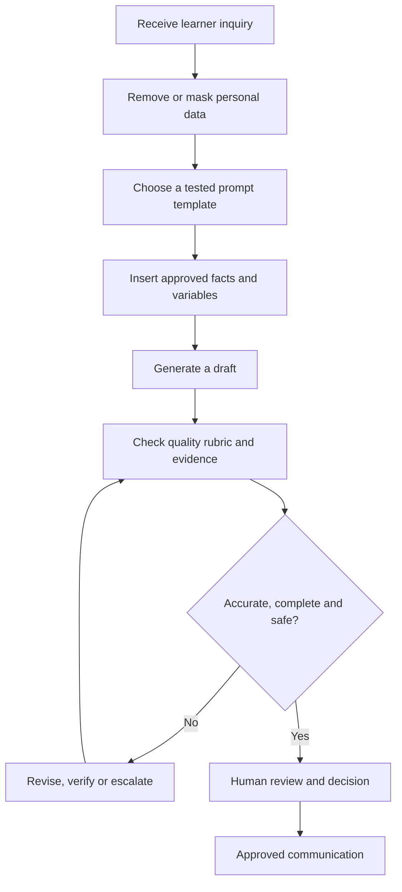

# Prompt Engineering & Responsible AI Use
## My Training Reflection and Learning Report

**SDAIA Academy | Riyadh, Saudi Arabia | 11–15 October 2026**  
**Instructor:** Abdullah Khalid AlShahrani  
**Prepared from:** Day 1–4 course materials  
**Perspective:** First-person reflection by a program participant

> **My biggest lesson:** Prompt engineering is not about finding a magic sentence that makes AI smart. It is about designing clear instructions, controlling quality, reusing what works, and taking responsibility for the result.


## Executive summary

I joined the *Prompt Engineering & Responsible AI Use* program to understand how AI assistants can be used more effectively in practical work. Across the training materials, one concept built on the next: **structured prompting**, **consistent output**, **reusable templates**, and finally **verification and responsible use**.

The program used a *Beneficiary Service Desk* scenario, in which a team responds to questions, summarizes requests and drafts messages. This gave me a consistent example to work through. Rather than treating each AI response as a standalone answer, I learned to think of the entire process: what information the assistant receives, what it is permitted to do, what format it must follow, what could go wrong, and who reviews the output.

The four supplied daily presentations are the basis of this report. The course overview mentions a fifth day devoted to a **Prompt Playbook and final project**, but I do not describe its activities in detail because a Day 5 presentation was not provided with this request. All diagrams in this report are my own summaries, not reproduced course slides.

---

## 01. Day 1: Prompting Foundations and the RACE Method 🧩

### How I now understand prompting

I learned that a prompt is more than a question. It includes the instructions and information that guide an AI assistant's response. A request can be grammatically correct yet still produce an unusable answer when it fails to explain the purpose, audience, constraints or expected form.

For example, asking an assistant to “write a reply” leaves several questions unanswered. Who am I replying as? What facts can be used? Should the reply be in Arabic or English? How long should it be? Does it need a next step? The training identified common causes of weak prompting: **unclear goals, missing context, too many tasks, no defined format, and no review**.

### RACE gave me a structure

The core technique was **RACE: Role, Action, Context and Expectation**.


| Component | What I learned | How I use it |
|---|---|---|
| **Role** | Give the assistant a clear professional perspective. | “Act as a training-center service desk agent.” |
| **Action** | State the task and the order of steps. | “Identify the learner’s questions, then draft a reply.” |
| **Context** | Supply the facts, audience and rules relevant to the task. | Include the approved policy information and the masked inquiry. |
| **Expectation** | Define a successful result. | Specify language, tone, length and output sections. |

The important insight for me was that *context is not optional*. If a rule is specific to an organization, I cannot expect the assistant to know it unless I provide it. I also learned to treat AI output as a draft, especially when it mentions names, figures, dates or organizational policies.

### Improving prompts is a deliberate process

The course introduced a simple refinement loop: **Write → Run → Review → Adjust**. It also taught a useful way to give feedback: **evidence + effect + edit**. Instead of saying, “This reply is bad,” I can identify the unsupported promise, explain why it is risky, and direct the assistant to remove it.

**My takeaway:** The first output is a starting point. I get better results by designing an instruction, testing what it produces, and improving the instruction rather than endlessly fixing individual replies.

---

## 02. Day 2: Consistent Quality and Output Control 🎛️

### A good answer once is not enough

Day 2 changed how I think about quality. A prompt that produces one convincing reply might fail on a different request. What matters is whether the response stays **accurate, complete, polite, correctly formatted, and actionable** across different inputs.

The course used a five-point quality rubric. I would apply it as follows:

| Check | Question I ask | Pass condition |
|---|---|---|
| **Accuracy** | Does every factual statement come from the supplied facts? | No invented rules or details. |
| **Completeness** | Did the reply cover every learner question? | No question skipped. |
| **Next step** | Does the learner know what to do next? | One clear, supported action. |
| **Tone** | Is the wording calm and professional? | No blame or unsupported promises. |
| **Format and language** | Does the answer follow the agreed template? | Correct structure, length and language. |

The slides scored each category **0 or 1**. A score of **5/5 meant ready for human review**, not automatically ready to send. That distinction matters: a checklist helps, but it does not replace judgment.

### What output control looks like

I learned to reduce variation by keeping a fixed prompt structure, separating facts from the incoming request, adding explicit rules, giving a sample output when appropriate, dividing complex tasks into steps, and telling the assistant what to do when information is missing. Arabic and English output also require explicit language instructions.

A rule such as **“Use only the supplied facts. If an answer is missing, say it is unavailable and refer the learner to the official channel”** is far more useful than “be accurate.” It gives the assistant a clear way to handle uncertainty.

### Privacy starts before prompting

Another major lesson was **data masking**. Names, phone numbers, email addresses, identity numbers, addresses, bank details and credentials should not be casually pasted into AI tools. In the training, we learned to replace unnecessary personal data with consistent labels such as `User-1`, `Phone-1`, and `Email-1`, or to generalize and remove details entirely.

For instance:

```text
Original training-style example:
A learner named [PERSON] asked about a certificate and provided a phone number.

Masked working input:
User-1 asked about a certificate. Contact: Phone-1.
```

The masked version still allows the assistant to work on the communication task while exposing less personal information. I would keep any mapping back to real identifiers outside the prompt and under the appropriate organizational controls.

**My takeaway:** Reliable AI use needs a repeatable standard, not just an impressive example. Privacy and consistent quality are part of prompt design, not last-minute additions.

---

## 03. Day 3: Reusable Dynamic Templates ♻️

### From writing again to designing once

Day 3 addressed an everyday inefficiency: copying an old prompt, editing multiple lines, and hoping no details from the previous case remain. I learned how to turn a working prompt into a **dynamic template** whose instructions stay fixed while selected values change.


The program represented variable fields inside square brackets, such as `[INQUIRY]`, `[LANGUAGE]`, `[TONE]`, `[MAX_WORDS]`, and `[DESK_FACTS]`. The naming convention matters because clearly named slots are easier for other people to fill correctly. The goal is to update only what changes, while keeping critical rules in place.

### My example of a reusable prompt

This is an **original illustrative template** based on the concepts taught in the program, not a transcription of a course slide:

```text
ROLE:
You are a learner support agent at a training center.

ACTION:
1. Read the inquiry and identify every question.
2. Answer each question using only [APPROVED_FACTS].
3. If a fact is missing, do not guess; say it needs checking.
4. End with one clear next step.

CONTEXT:
[APPROVED_FACTS]

LEARNER MESSAGE:
---
[MASKED_INQUIRY]
---

SAFETY RULES:
- Do not invent dates, amounts, status updates, or policies.
- Do not request passwords, ID numbers, or banking details.
- A staff member must review the draft before sending.

EXPECTATION:
Language: [LANGUAGE]
Tone: [TONE]
Maximum length: [MAX_WORDS] words
Format: Greeting / Answer / Next step / Closing
```

I can use the same template for a certificate question, registration inquiry, or schedule request, as long as I supply the relevant approved facts and appropriate masked input. If the *task itself* changes, such as moving from replying to **classifying** a request, I should create a different template rather than force one prompt to do everything.

### Why a prompt library matters

The program also covered how to organize a small prompt library. I understood this as a collection of **named, tested and reusable instructions**. Each entry should clarify its purpose, expected variables, limits and testing status. A shared library helps teams avoid slightly different versions of the same rule and makes updates easier to manage.

**My takeaway:** The value of prompt engineering grows when a prompt can be understood, tested and reused by someone other than its creator.

---

## 04. Day 4: Verification and Responsible AI Use 🛡️

### Sounding correct is not the same as being correct

Day 4 focused on **hallucinations**, meaning outputs that sound plausible but include false or unsupported information. In a service environment, that could mean inventing a refund date, claiming that a request has been approved, quoting a policy that was never supplied, or suggesting that an action was already completed.

I learned not to confuse a professional tone with evidence. The slides also made an important point about outdated facts: an answer may follow the prompt perfectly while relying on a policy block that is no longer current. Verification therefore has to look beyond whether the AI obeyed the prompt.

### Three layers of protection


1. **Prevent:** Put explicit rules and missing-information instructions in the template.
2. **Detect:** Review the response against the inquiry, approved facts and any relevant current notice.
3. **Decide:** Have a person correct, escalate, approve or reject the draft.

A useful review asks: What does the output claim? Where did that claim come from? Does the evidence actually support it? Were any questions skipped? Did the answer imply an action or promise that no one authorized?

### Responsible use is a working practice

The training connected verification with **privacy, fairness, organizational policy and human accountability**. I learned that a responsible workflow should minimize sensitive input, check for unsupported assumptions or unfair treatment, communicate uncertainty rather than hide it, and give staff ownership of the final decision.

It also matters that source facts are current. A carefully written prompt cannot compensate for an outdated policy statement. If the evidence is wrong, the draft can still be wrong. This made me see fact maintenance and reviewer sign-off as part of the wider AI process.

**My takeaway:** Responsible AI is not achieved by adding “be ethical” at the end of a prompt. It requires safeguards before, during and after generation.

---

## 05. Putting the learning together: my proposed workflow 🔧

The diagram below is my own synthesis of the four days. It shows how I would apply these lessons to a training-center service desk. It is a **proposed process**, not a claim that a live system has been deployed.



### How I would measure success

I would use a small test set containing different inquiry types, Arabic and English cases, multi-question messages, and cases where a fact is deliberately missing. I would score outputs against the five quality criteria, note recurring errors, and update the underlying prompt or fact source. I would also record whether a human reviewer had to correct unsupported claims.

I would not judge success only by the speed of drafting. A fast response that invents a policy or leaks personal data is not an improvement. The practical goal is to reduce avoidable rework **while maintaining quality and accountability**.

## 06. Skills I developed and where I can use them

| Skill | What it means for my work |
|---|---|
| **Structured thinking** | I can break an ambiguous request into role, task, evidence and expected output. |
| **Quality assurance** | I can evaluate answers against defined criteria instead of relying on whether they “sound good.” |
| **Template design** | I can create reusable instructions for recurring work. |
| **Information handling** | I recognize when information should be masked, withheld, or verified. |
| **Critical review** | I can identify hallucinations, missing answers and unsupported promises. |
| **Process improvement** | I can connect AI assistance to a human-controlled operational workflow. |

These lessons feel especially relevant to business analysis, consulting and project work, where I frequently need to structure information, summarize stakeholder requests and communicate clearly. I can apply the techniques to a project meeting summary, requirements review or structured research draft, provided that I use approved information and verify the final result. Those are **my own potential applications** of the course concepts, not exercises explicitly documented in the four uploaded decks.

## 07. My final reflection

The most meaningful change in my perspective is that I no longer see prompting as simply asking an AI assistant to perform a task. I see it as **designing the conditions under which an AI-generated draft can be useful and reviewed responsibly**.

Day 1 taught me to give better instructions. Day 2 taught me to expect consistent results. Day 3 taught me to make those instructions reusable. Day 4 taught me to question the result and protect the people affected by it. Together, those lessons provide a practical foundation for using AI in professional workflows.

> **What I am taking forward:** Be precise about the task. Be careful with the data. Make the method reusable. Check the evidence. Keep a human responsible for the outcome.

---

## Source notes and attribution

**Primary source:** Training presentations supplied for the *Prompt Engineering & Responsible AI Use* program, SDAIA Academy, 11–15 October 2026.

- **Day 1:** *Prompting Foundations & the RACE Method* (39 pages): prompt basics, RACE, iteration, and the service-desk scenario.
- **Day 2:** *Consistent Quality & Output Control* (33 pages): quality rubric, masking, rules, output structure, language control and testing.
- **Day 3:** *Reusable Dynamic Templates* (40 pages): variables, fixed and dynamic sections, reusable templates and prompt libraries.
- **Day 4:** *Verification & Responsible Use* (39 pages): hallucinations, defense layers, evidence checks, privacy, bias and human decisions.

**Scope and accuracy note:** This report is based on the four supplied presentations. The discussion of Day 5 comes only from the course overview in Day 1. Reflection and proposed applications are my interpretation, not instructor quotations or claims about measured real-world outcomes.

**Visual credits:** All three illustrations above are original diagrams developed for this report from the training concepts. No slide screenshots or third-party photographs were reproduced. Icons are Unicode symbols; no external icon library was required.

**External resources used:** None. Accordingly, no claims depend on external websites or require outside URLs.
