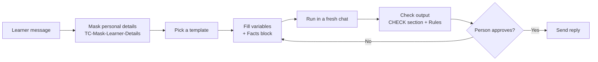

# TC Prompt Library — Learner Support Desk

## Training program

This project was completed as part of the Prompt Engineering and Responsible AI Use training program at SDAIA Academy, under the supervision of [Abdullah Khalid Alshahrani](https://www.linkedin.com/in/abdullah-alshahrani-9125bb2a0/).

The project demonstrates the practical application of prompt engineering and responsible AI use — building a clean, approved prompt library through structured RACE prompts, reusable templates with variables and fixed output formats, safe handling of sensitive data, verification and responsible-use rules, and a documented three-test quality report.

Official SDAIA Academy GitHub: https://github.com/SDAIAAcademy

---

> A clean, tested and approved prompt library that helps a training center's support desk draft safe, consistent replies to learners — with a person approving every output.


Final project for Day 5 of the **Prompt Engineering & Responsible AI Use** program.

| | |
|---|---|
| **Owner** | Alhanouf Aldossary |
| **Path** | B — Guided path |
| **Scenario** | B1 — Learner Support Desk at a Training Center (prefix `TC`) |
| **Date** | 2026-10-15 |
| **Library folder** | [`PE_Project_AlhanoufAldossary/`](PE_Project_AlhanoufAldossary/) |

---

## Contents

- [Training program](#training-program)
- [Scenario](#scenario)
- [Workflow](#workflow)
- [Templates](#templates)
- [Test results](#test-results)
- [Quick start](#quick-start)
- [Library structure](#library-structure)
- [Responsible use](#responsible-use)

---

## Scenario

Learners write to the desk about **registration, schedules, certificates and refunds**. The desk agent uses AI to draft replies, and a person reviews each reply before it is sent.

> [!NOTE]
> All data in this project is invented — no real organization, person, number or document is used.

## Workflow



## Templates

Ten tasks were scoped for the scenario; five were built, tested and approved.

### Built ✅

| No. | Task | Goal | Template |
|---|---|---|---|
| 1 | Answer a learner's question | Write a short, polite answer using only the Center Facts. | [`TC-Reply-Inquiry-v1`](PE_Project_AlhanoufAldossary/templates/TC-Reply-Inquiry-v1_2026_10_15.md) |
| 2 | Condense a learner's complaint | Summarize a long complaint in three lines for the registration officer. | [`TC-Summarize-Complaint-v2`](PE_Project_AlhanoufAldossary/templates/TC-Summarize-Complaint-v2_2026_10_15.md) |
| 3 | Sort incoming requests | Label each request as Registration, Schedule, Certificate, Refund or Other. | [`TC-Classify-Requests-v1`](PE_Project_AlhanoufAldossary/templates/TC-Classify-Requests-v1_2026_10_15.md) |
| 4 | Soften a staff draft | Rewrite a rushed or rude staff draft as a calm, polite message. | [`TC-Soften-Staff-Draft-v1`](PE_Project_AlhanoufAldossary/templates/TC-Soften-Staff-Draft-v1_2026_10_15.md) |
| 8 | Hide learner details | Replace names, phone numbers and emails with codes before the message goes to an AI tool. | [`TC-Mask-Learner-Details-v2`](PE_Project_AlhanoufAldossary/templates/TC-Mask-Learner-Details-v2_2026_10_15.md) |

### Not built (future work)

| No. | Task | Goal |
|---|---|---|
| 5 | Bilingual course notice | Translate an approved course notice between Arabic and English without changing any date or fact. |
| 6 | Course start reminder | Write a reminder about the course start time and what the learner should bring. |
| 7 | Schedule change apology | Write a short apology for a schedule change without promising any compensation. |
| 9 | Registration FAQ sheet | Turn five common registration questions and their facts into a short FAQ list. |
| 10 | Refund exception note | Write a short note for the supervisor when a refund exception needs a person's decision. |

### Shared building blocks

| File | Purpose |
|---|---|
| [`TC-Facts-v1`](PE_Project_AlhanoufAldossary/blocks/TC-Facts-v1_2026_10_15.md) | The single source of center policy used by every template. |
| [`TC-Rules-v1`](PE_Project_AlhanoufAldossary/rules/TC-Rules-v1_2026_10_15.md) | Verification and responsible-use rules every output is checked against. |

## Test results

Each template was tested in ChatGPT with **two different fills and one edge case**, each in a fresh chat.

| Template | Prompt /5 | Template /6 | Output /5 | Status |
|---|:---:|:---:|:---:|:---:|
| TC-Reply-Inquiry-v1 | 5 | 6 | 5 | ✅ Approved |
| TC-Summarize-Complaint-v2 | 5 | 6 | 5 | ✅ Approved |
| TC-Classify-Requests-v1 | 5 | 6 | 5 | ✅ Approved |
| TC-Soften-Staff-Draft-v1 | 5 | 6 | 5 | ✅ Approved |
| TC-Mask-Learner-Details-v2 | 5 | 6 | 5 | ✅ Approved |

Two templates (`Summarize-Complaint` and `Mask-Learner-Details`) needed one fix and a retest — their v1 files are kept in [`_archive/`](PE_Project_AlhanoufAldossary/_archive/). Full details and screenshots are in the [Test Results Report](PE_Project_AlhanoufAldossary/Test_Results_Report.pdf), and the run log is in [`test_run_log.md`](test_run_log.md).

## Quick start

Full instructions are in [`library_guide.md`](PE_Project_AlhanoufAldossary/library_guide.md). In short:

1. **Mask** the learner's message with `TC-Mask-Learner-Details-v2`.
2. **Copy** the template that fits the task.
3. **Fill** the variables using the Facts block and invented or masked text only.
4. **Run** it in a fresh chat.
5. **Check** the output against the template's CHECK section and the Rules file.
6. **Approve** — a person reviews the draft before anything is sent.

## Library structure

```text
.
├── README.md
├── test_run_log.md               test run log
└── PE_Project_AlhanoufAldossary/
    ├── library_index.md          table of the 5 templates, blocks, rules, [LANGUAGE] values, change log
    ├── library_guide.md          how to use the library (about one page)
    ├── Test_Results_Report.pdf   summary page + one page per template with a screenshot
    ├── blocks/
    │   └── TC-Facts-v1_2026_10_15.md
    ├── templates/
    │   ├── TC-Reply-Inquiry-v1_2026_10_15.md
    │   ├── TC-Summarize-Complaint-v2_2026_10_15.md
    │   ├── TC-Classify-Requests-v1_2026_10_15.md
    │   ├── TC-Soften-Staff-Draft-v1_2026_10_15.md
    │   └── TC-Mask-Learner-Details-v2_2026_10_15.md
    ├── rules/
    │   └── TC-Rules-v1_2026_10_15.md
    └── _archive/
        ├── TC-Summarize-Complaint-v1_2026_10_15.md
        └── TC-Mask-Learner-Details-v1_2026_10_15.md
```

**Naming convention:** `TC-<Action>-<Object>-v<version>_<YYYY_MM_DD>.md`

## Responsible use

| Principle | In practice |
|---|---|
| 🧑‍💼 **Human in the loop** | The AI only drafts. A person checks and approves every output. |
| 📋 **One source of truth** | The Facts block is the only source of policy. Anything else is marked `NOT IN FACTS`, never guessed. |
| 🔒 **Privacy first** | The desk never asks for ID numbers, passwords or bank details, and personal data is masked before any AI use. |
| ⚖️ **Fair treatment** | Every learner gets the same facts and tone, whatever their name or background. |
